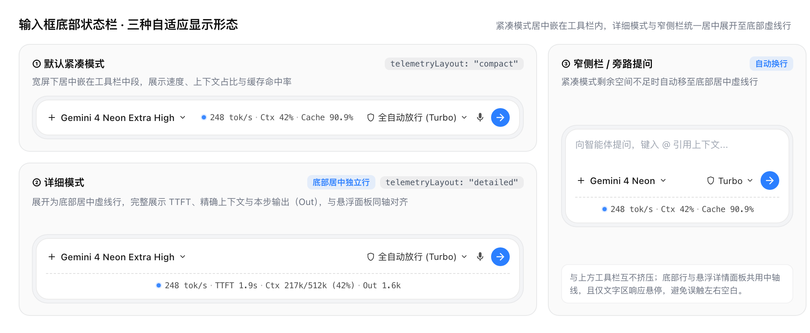
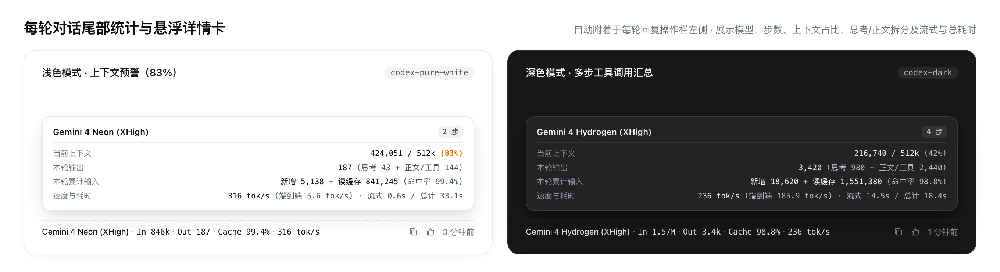
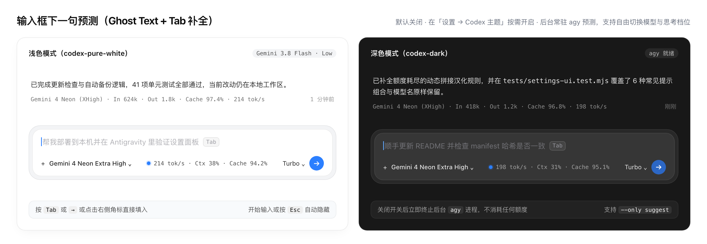

<div align="center">

<h1>antigravity-enhancer</h1>

<p><strong>Google Antigravity 纯本地零外联增强工具：全量中文界面、实时本地用量统计、右键外部打开与原生设置面板</strong></p>

<p>
  <a href="#快速安装">快速安装</a> ·
  <a href="#按需安装">按需安装</a> ·
  <a href="#功能详解">功能详解</a> ·
  <a href="#自定义与卸载">自定义与卸载</a> ·
  <a href="#致谢与协议">致谢与协议</a> ·
  <a href="#english-overview">English</a>
</p>

<p>
  不修改安装包、不覆盖原生配色、<strong>默认零外联</strong>（仅手动点击在线更新时直连 GitHub 官方仓库并校验 SHA-256）。<br>
  通过本地 <code>127.0.0.1</code> CDP 实时注入 5,200+ 词条中文汉化、本地四态会话统计、简化版右键外部打开与原生设置面板。
</p>

<p>
  
  = 22.13.0">
  
  
  <a href="LICENSE"></a>
</p>

</div>

| 模块 | 核心能力 | 启用方式 |
| :--- | :--- | :--- |
| **中文界面汉化 (`i18n`)** | 内置 `5,200+` 词条、Shadow DOM 穿透、快捷键后缀/权限审批/配额提示/Swarm 动态翻译，`WeakMap` 原地替换，关闭即恢复英文 | 默认开启 |
| **本地会话状态与统计 (`metrics`)** | 仅读本地 SQLite 与日志：底部四态状态指示、一/二级用量明细面板、每轮悬浮详情卡（覆盖主对话与旁路提问） | 默认开启 |
| **右键外部打开 (`openIn`)** | 在回复中的文件链接/路径上右键，直接用 **IDEA / Finder / Zed / VS Code / Cursor** 打开并精准跳转行号，不影响左键 | 默认开启 |
| **原生设置面板** | 嵌入 **设置 → Antigravity增强**，继承原生浅/深色配色，热重载同步至 `user/config.json` | 默认内置 |
| **实用修复 (`fixes`)** | 修复设置弹窗路由死锁、补充 `Cmd/Ctrl + -/=/0` 缩放快捷键与 `2.33.0+` 单图标冷启动 CDP 接力 | 默认开启 |
| **输入框下一句预测 (`suggest`)** | 回复结束后显示 Ghost Text，按 `Tab` / `→` 补全，内置本地 `agy models` 二级级联模型选择 | **默认关闭**（按需开启） |

> **为什么选择 `antigravity-enhancer`？**
> - **保留原生外观**：完整移除主题配色覆写，完全跟随 Antigravity 原生浅色/深色主题。
> - **默认零外联 + 手动在线热更新**：核心功能严格仅通过本地 `127.0.0.1` CDP 运行；仅在手动点击 **设置 → Antigravity增强 → 插件更新** 或执行 `node install.mjs update` 时直连 `Solonggg/antigravity-enhancer` 并逐文件校验 SHA-256，无需重启 Antigravity 即可热更新生效。
> - **单一后台守护进程**：将汉化、本地统计与右键外部打开统一整合在一个轻量常驻进程中，安装时自动清理旧版 `antigravity-codex-theme` 与独立 `antigravity-open-in` 后台服务。

## 快速安装

> **前置要求**：**Node.js >= 22.13.0**（见 [package.json](package.json)）与 Google Antigravity（`2.30.x` ~ `2.35.1+`）。插件仅部署至 `~/.gemini/antigravity/enhancer`，**不修改应用安装包**。

### 命令行安装

```bash
git clone https://github.com/Solonggg/antigravity-enhancer.git
cd antigravity-enhancer
node install.mjs install
node --disable-warning=ExperimentalWarning install.mjs doctor
```

若安装前 Antigravity 已在未开启调试端口的状态下运行，重启一次应用或在外部终端运行 `node install.mjs relaunch` 即可生效。

### AI 一键安装

将下面提示词发给 Antigravity、Claude Code、Codex 或 Cursor：

> 请读取 `https://github.com/Solonggg/antigravity-enhancer.git`，参考仓库内 `SKILL.md` 拉取 `core` 与 `user` 目录，运行 `node install.mjs install`、`node --disable-warning=ExperimentalWarning install.mjs doctor` 和 `verify` 完成安装并确认实时注入正常。

### 按需安装

通过 `--only` 或 `--without` 从 `i18n`、`metrics`、`openIn`、`fixes`（默认开启）及 `suggest`（默认关闭）中按需组合：

```bash
# 示例：仅启用中文界面与右键外部打开
node install.mjs install --only i18n,openIn

# 示例：排除下一句预测与统计面板，仅保留汉化 + 右键打开 + 修复
node install.mjs install --without metrics
```

<details>
<summary>查看常用运维、回滚与测试命令</summary>

| 命令 | 用途 |
| :--- | :--- |
| `node install.mjs install [--channel auto\|stable\|insiders] [--only <features>] [--without <features>] [--minimal] [--with-launcher] [--sync-user]` | 部署插件、清理旧版服务并注册后台自启服务 |
| `node install.mjs check-update [--target-dir <dir>]` | 检查 GitHub `main` 最新版本与待变更文件清单（只读，不修改本地文件） |
| `node install.mjs update [--force] [--target-dir <dir>]` | 从 GitHub 拉取变更文件、逐文件校验 SHA-256、自动备份 `core.prev` 并热重载生效（保留 `user/` 配置，无需重启 Antigravity） |
| `node install.mjs relaunch [--channel auto\|stable\|insiders] [--force]` | 携带 `--remote-debugging-port=0` 重启 Antigravity 并校验注入（含 15s 活跃会话保护） |
| `node --disable-warning=ExperimentalWarning install.mjs doctor` | 检查 Node 版本、CDP 状态、`core/manifest.json` 哈希及页面挂载状态 |
| `node --disable-warning=ExperimentalWarning install.mjs verify [--safe-mode]` | 单次注入并校验；`--safe-mode` 跳过 `user/` 自定义脚本以便排障 |
| `node install.mjs sparse-paths --only <features>` | 输出指定模块组合的稀疏拉取路径清单 |
| `node install.mjs rollback` | 回滚至上一份备份的 `core/` 版本 |
| `node install.mjs uninstall` | 停止服务、清理自启项与启动参数，恢复原始英文界面 |
| `npm run check` / `npm test` | 校验全部 `.mjs` 与拼接后的前端脚本语法，运行全量 `node:test` 单元测试 |

</details>

## 功能详解

### 1. 中文界面汉化（全面审计补全）

- **5,200+ 精校词条**：在原 `1,937` 条核心词条基础上，逐类审计补全了设置页、MCP 与知识库、智能体、权限审批、语音、浏览器、密钥管理、Swarm 协作面板与主界面等 `3,300+` 条漏翻文案。
- **Shadow DOM 穿透与智能回退**：自动监听并翻译已挂载与动态创建的 Shadow DOM 子树；支持全角/弯引号归一化回退、带快捷键后缀的标签/提示（如 `Settings (Cmd+,)`）、权限审批句式（如 `Yes, and always allow ...`）、列表展开提示及 Swarm 作用域状态。
- **安全可逆**：保留模型名与思考档位原文（`Low` / `Medium` / `High` / `Extra High` / `Orchestrator` / `Antigravity`）；采用 `WeakMap` 原地更新文本节点，关闭开关即可即时还原英文（含 Shadow DOM）；支持通过 [user/i18n.override.json](user/i18n.override.json) 覆写自定义词条。

### 2. 右键打开文件引用（精简子功能）

- **被动拦截，不影响左键**：仅在用户右键点击回复中的 `file://` 链接、React 文件引用组件、代码块/文本中的本地绝对路径（支持 `#L10`、`#L10-L25`、`#L10C4`、`:42`、`:42:12`）或选中路径文本时弹出简洁右键菜单；左键点击仍保持 Antigravity 原生行为。
- **精简面板选项**：整合进 **设置 → Antigravity增强**，无需独立后台进程与冗余开关：
  - **5 个核心目标开关胶囊**：`IDEA`、`Finder`、`Zed`、`VS Code`、`Cursor`（带本机探测绿点，点击即切换）。
  - **按需展开 IDEA 路径**：启用 `IDEA` 时单行展示自动探测到的启动器路径，点击「自定义路径」才展开输入框与保存/重置按钮。
  - **默认附带复制路径**：菜单默认提供 `复制路径` / `复制路径:行号`，无需在界面额外占行开关。
- **零 Shell 注入安全设计**：所有打开动作均通过 `execFile(bin, argsArray)` 离散参数数组执行，不经由 shell 拼接；严格校验本地绝对路径与磁盘存在性；高级自定义命令目标（`openIn.customTargets`）仅允许在本地 `user/config.json` 中配置，渲染端不可注入任意可执行命令。

### 3. 本地会话状态与用量统计

仅读取本机 Antigravity SQLite 会话数据库与 `language_server.log`，无任何远端探测或数据上传：

| 会话状态 | 圆点样式 | 触发条件 |
| :--- | :--- | :--- |
| 就绪 | **蓝色常亮** | 连接正常且空闲；主动取消生成后立即恢复 |
| 执行中 | **蓝色闪烁** | 模型流式输出、`/compact` 压缩或工具调用进行中 |
| 等待或重试 | **黄色脉冲** | 首字/单步等待 `>= 60s`、模型自动重试或建连耗时 `3s ~ 11s` |
| 连接或执行异常 | **红色脉冲** | 网络离线、建连超时 `>= 12s`、API/步骤报错或后台心跳超时 `>= 90s` |






### 4. 输入框下一句预测（可选，默认关闭）

回复结束后根据当前上下文预测下一句指令，以幽灵灰字（Ghost Text）显示在空输入框中，按 `Tab` 或 `→` 填入；未开启时不启动后台 `agy` 进程。



## 自定义与卸载

### 日常配置（`user/config.json`）

日常开关、右键目标、IDEA 路径与状态栏偏好推荐直接在 **设置 → Antigravity增强** 中调整，修改会实时写入 `~/.gemini/antigravity/enhancer/user/config.json` 并热重载生效：

```json
{
  "enabled": true,
  "channel": "auto",
  "telemetryLayout": "compact",
  "telemetryCacheMode": "session",
  "contextLimit": "auto",
  "modules": {
    "i18n": true,
    "metrics": true,
    "openIn": true,
    "promptSuggestions": false,
    "deadlockHealer": true,
    "zoomShortcuts": true,
    "cdpAutoRelaunch": true,
    "customCss": true,
    "customJs": true
  },
  "openIn": {
    "targets": ["idea", "finder"],
    "ideaPath": "",
    "copyPath": true
  }
}
```

> 如需在右键菜单添加自定义命令目标，可在 `user/config.json` 的 `openIn.customTargets` 中手动追加（如 `[{ "id": "subl", "label": "在 Sublime 中打开", "command": "subl", "args": ["{path}:{line}"], "argsNoLine": ["{path}"] }]`）。

### 源码定制与测试

修改 `core/` 后运行以下命令重建哈希清单、校验语法并执行全部单元测试：

```bash
node install.mjs build-manifest && npm run check && npm test && node install.mjs install
```

### 卸载

执行 `node install.mjs uninstall` 将停止后台进程、移除系统自启项与托管的 CDP 启动器，并将当前窗口恢复为原始英文界面，同时保留 `~/.gemini/antigravity/enhancer/user/` 个人配置与备份。

## 致谢与协议

本项目基于以下优秀开源项目二次重构与整合，特此致谢：

- [nkjDSLcvanv/antigravity-codex-theme](https://github.com/nkjDSLcvanv/antigravity-codex-theme)（MIT）：提供模块化 CDP 注入守护进程、原生设置面板框架、四态会话状态机、本地 SQLite 用量统计、输入框下一句预测与 `2.33.0+` 冷启动接力机制。
- [qqxpee/antigravity2-cn](https://github.com/qqxpee/antigravity2-cn)（MIT）：参考其 Shadow DOM 穿透思路、动态文案规则并审计补全了大量缺失中文界面词条。
- `antigravity-open-in`：整合其被动右键文件引用解析器与无 Shell 注入的安全外部打开实现，并精简为一体化子模块。
- [Anarcadia/chuanban-antigravity-theme-patch](https://github.com/Anarcadia/chuanban-antigravity-theme-patch)（MIT）：上游早期 CDP 注入与 `WeakMap` 汉化研究。

基于 [MIT License](LICENSE) 开源。

## English Overview

`antigravity-enhancer` is a 100% local, zero-outbound enhancement suite for Google Antigravity (`2.30.x` – `2.35.1+`) without modifying application bundles or overriding native themes (requires Node.js `>= 22.13.0`).

- **Local-First & On-Demand Hot Updates**: No theme overrides, no SSH Remote, and no background network polling—only local `127.0.0.1` CDP by default; manually click **Check Updates / Hot Update** in Settings or run `node install.mjs update` to pull SHA-256-verified updates directly from `Solonggg/antigravity-enhancer` without restarting Antigravity.
- **Expanded Chinese UI Localization (`i18n`)**: `5,200+` curated entries with Shadow DOM penetration, smart-quote fallback, shortcut-suffixed labels, permission prompts, and Swarm frame support—reversible in place via `WeakMap`.
- **Simplified Right-Click Open In (`openIn`)**: Passive `contextmenu` menu on file links/paths in replies to open in `IDEA`, `Finder`, `Zed`, `VS Code`, or `Cursor` with line/column jumping (discrete `execFile` args, zero shell interpolation, left-click untouched).
- **Local Session Status & Usage Stats (`metrics`)**: Reads local SQLite & logs for the 4-state bottom status indicator, expandable L1/L2 panels, and per-turn hover cards.
- **Embedded Settings Panel & Opt-In Prompt Suggestions**: Manage all modules live under **Settings → Enhancer** (`设置 → Antigravity增强`) with instant hot-reload to `user/config.json`.

Licensed under the [MIT License](LICENSE).
