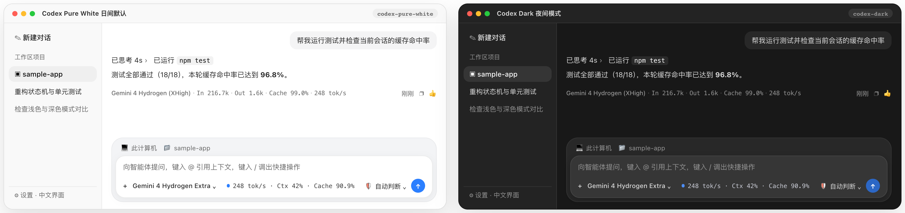
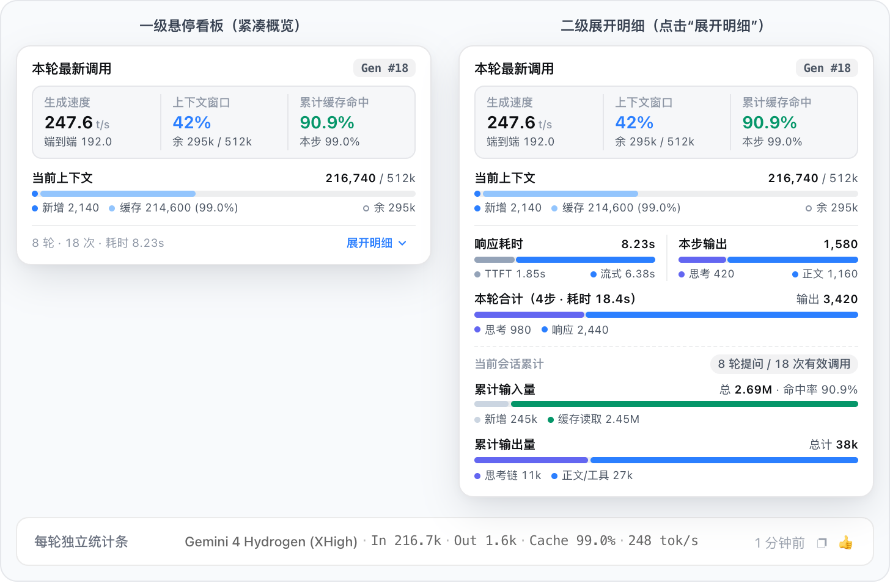
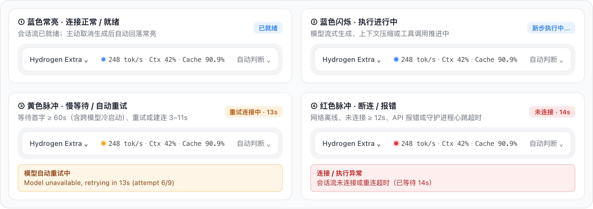

# antigravity-codex-theme

**Google Antigravity 的 Codex 极简昼夜主题、中文界面汉化与增强状态统计插件**

[效果截图](#效果截图) · [核心功能](#核心功能) · [快速安装](#快速安装) · [配置说明](#配置与热更新) · [致谢与开源协议](#致谢与开源协议)

---

> **开源来源与改造说明**
> 本项目基于开源项目 [**chuanban-antigravity-theme-patch**](https://github.com/Anarcadia/chuanban-antigravity-theme-patch)（作者：[@Anarcadia](https://github.com/Anarcadia)）进行改造与模块化重构：保留其零侵入 CDP 热注入与高性能 DOM 汉化引擎作为基础，将默认视觉切换为 **Codex 极简纯白 / 炭灰暗夜主题**，内置 900+ 词条界面汉化，并重点强化了 **四态状态指示灯、两级可展开可视化统计面板与每轮对话尾部统计**。

---

## 效果截图

### 1. Codex 纯白 / 深灰双模式、界面汉化与每轮对话尾部统计



### 2. 一级概览面板、二级详情面板与每轮尾部统计



### 3. 输入框四态状态指示灯（蓝常亮 / 蓝闪烁 / 黄脉冲 / 红脉冲）



---

## 核心功能

### 1. 四态实时状态指示灯 + 输入框底部状态栏
在输入框底部工具栏正中（模型选择与权限/发送按钮之间）展示实时状态小圆点与简洁摘要：

```text
● 248 tok/s · Ctx 42% · Cache 90.9%
```

窄窗口时自动降级为输入框底部的细虚线独立一行。状态灯实时反映当前窗口连接与执行健康度：

| 指示灯状态 | 含义 | 触发条件 |
| :--- | :--- | :--- |
| **蓝色常亮** | 连接正常、已就绪 | 会话流已正常连接并处于空闲状态；手动点击停止（Cancel）后立即恢复常亮 |
| **蓝色闪烁** | 正在执行 | 模型推理输出、`/compact` 压缩或工具调用正在推进 |
| **黄色脉冲** | 慢等待 / 自动重试 / 建连中 | 等待首字或步骤推进超过 `60s`（如切换模型后 `/compact` 重算上下文缓存）、模型不可用自动重试连接，或会话流建连延迟 `3s–11s` |
| **红色脉冲** | 断连或执行报错 | 网络离线、会话未连接超时 `>= 12s`、API/步骤报错（已过滤手动取消），或后台同步进程无响应超过 `90s` |

### 2. 两级可展开可视化统计面板
- **悬停或单击状态栏 → 展开一级面板**：查看当前最新一次调用的生成速度（`tok/s` 与端到端均值）、上下文占用百分比及剩余容量、累计缓存命中率、当前上下文分段条（新增 / 写缓存 / 读缓存 / 剩余）以及异常或慢等待原因提示。
- **再点一下状态栏（或点击「展开明细」）→ 展开二级面板**：进一步展示首字延迟（TTFT）与流式耗时分布、Thinking 与正文输出拆分、本轮多步合计，以及整个会话的累计输入/输出总览。
- **点击页面空白处、按 `Esc` 或再次点击状态栏**即可收起面板。

### 3. 每轮对话尾部统计
在每次助手回复底部的操作栏左侧，自动附上该轮完整统计小字条：

```text
Gemini 4 Hydrogen (XHigh) · In 216.7k · Out 1.6k · Cache 99.0% · 248 tok/s
```

鼠标悬停在上面时，会用悬浮提示展示该轮包含的步数、精确上下文占用、`Thinking` 与正文/工具分别消耗的 token 数量、缓存读取比例以及流式/总耗时。

### 4. 中文界面汉化（900+ 词条）
- 覆盖设置弹窗、模型选择器、权限模式、侧边栏会话菜单、命令审批与工具状态等常见英文界面文本。
- 基于 `WeakMap` 在原文本节点直接更新，不克隆或破坏 React 事件绑定；自动跳过代码块、`pre`、Monaco 编辑器、终端、用户提问气泡与会话标题。
- 支持通过 [user/i18n.override.json](user/i18n.override.json) 热更新补充或覆盖词条，也可以在配置中随时关闭汉化恢复原版英文。

### 5. Codex 极简纯白 & 炭灰暗夜双模式
- **日间默认 (`codex-pure-white`)**：`#FFFFFF` 纯白背景、`#F9F9F9` 侧边栏、`#EFEFEF` 选中条、`#2B7FFF` 主按钮与悬浮双层圆角输入框（`#F3F4F6` 外托盘 + `#FFFFFF` 内卡片），全局采用干净的系统无衬线与等宽字体栈，无需额外安装字体。
- **夜间模式 (`codex-dark`)**：对应 Codex 桌面端中性炭灰深色方案——`#181818` 主背景、`#232323` 侧栏、`#353535` 选中圆角条、`#282828` 外托盘、`#363636` 输入卡片与 `#2C67C5` 主按钮。
- **实用小修复**：顺带修复 Antigravity 设置弹窗路由死锁、补齐 macOS (`Cmd + -/=/0`) 与 Windows/Linux (`Ctrl + -/=/0`) 界面缩放快捷键；所有注入仅通过本地 CDP 在渲染层生效，不修改 Antigravity 安装包文件。

---

## 快速安装

> **前置要求**：Node.js **>= 22.0.0**（推荐 **>= 22.13.0**，用于启用内置 `node:sqlite` 实时统计读取）以及 Google Antigravity。

```bash
git clone https://github.com/<your-username>/antigravity-codex-theme.git
cd antigravity-codex-theme

# 安装并注册后台自启服务（支持 macOS LaunchAgents / Linux systemd / Windows schtasks）
node install.mjs install

# 检查运行环境、文件完整性与窗口注入状态
node --disable-warning=ExperimentalWarning install.mjs doctor
```

> **提示**：安装器会自动向 `~/.antigravity/argv.json` 写入 `"remote-debugging-port": 9222`（Insiders 为 `9223`）。如果 Antigravity 在安装前已经打开且之前未开启调试端口，**彻底退出并重启一次 Antigravity** 即可生效。

<details>
<summary>常用 CLI 命令</summary>

| 命令 | 用途 |
| :--- | :--- |
| `node install.mjs install [--channel auto\|stable\|insiders] [--sync-user]` | 部署到 `~/.gemini/antigravity/codex-theme` 并注册后台守护服务 |
| `node --disable-warning=ExperimentalWarning install.mjs doctor` | 自检 Node 版本、调试端口、`core/manifest.json` 哈希及实时页面状态 |
| `node --disable-warning=ExperimentalWarning install.mjs verify [--safe-mode]` | 单次注入并验证挂载结果；带 `--safe-mode` 可排查自定义配置冲突 |
| `node install.mjs rollback` | 回滚到上一个备份的 `core/` 版本 |
| `node install.mjs uninstall` | 停止服务、清理开机自启并还原原版英文界面（保留 `user/` 个人配置） |
| `npm test` | 运行 Protobuf 解析、四态状态机与仓库完整性单元测试 |

</details>

---

## 配置与热更新

个人配置位于 `~/.gemini/antigravity/codex-theme/user/`，修改后约 2.5 秒自动推入正在运行的窗口，无需重启 Antigravity：

- [user/config.json](user/config.json)
  - `preset`：`"codex-pure-white"`（日间默认）或 `"codex-dark"`（深色自动切换）
  - `telemetryLayout`：`"compact"`（默认紧凑条 `tok/s · Ctx % · Cache %`）或 `"detailed"`（显示 `TTFT` / 绝对 token / `Out`）
  - `telemetryCacheMode`：`"session"`（默认累计缓存命中率）或 `"step"`（当前步命中率）
  - `modules`：按需独立开关 `i18n`（汉化）、`metrics`（统计面板与状态灯）、`deadlockHealer`、`zoomShortcuts`、`customCss`、`customJs`
- [user/i18n.override.json](user/i18n.override.json)：追加或覆盖个人习惯的词条映射（例如保留模型思考强度英文后缀 `Low` / `Medium` / `High`）
- [user/custom.css](user/custom.css) / [user/custom.js](user/custom.js)：自定义样式与前端脚本钩子

---

## 目录结构

```text
antigravity-codex-theme/
├── assets/                     # README 效果截图
├── core/
│   ├── daemon/                 # 后台同步服务（配置热加载 / Protobuf 解析 / 日志重试 / 面板渲染 / SQLite / CDP）
│   ├── runtime/                # 按序拼接注入的浏览器脚本（生命周期 / 修复补丁 / 昼夜同步 / 状态机 / 统计界面 / 汉化引擎）
│   ├── styles/                 # 样式拆分（基础结构 / Codex 纯白 / Codex 深灰 / 状态灯与统计面板）
│   ├── installer/              # Manifest 校验与打包 / 环境探测 / 跨平台自启管理
│   ├── daemon.mjs              # 后台服务入口
│   ├── shared.mjs              # 公共工具函数
│   ├── i18n.json               # 900+ 界面汉化词典
│   └── manifest.json           # core/ 文件 SHA-256 清单
├── tests/                      # 单元测试（node:test）
├── user/                       # 用户自定义与热更新目录
├── install.mjs                 # 安装与运维 CLI
├── SKILL.md                    # 供 AI Agent 使用的操作说明
└── LICENSE                     # MIT License
```

---

## 致谢与开源协议

- **致谢原开源项目**：本项目基于 [**Anarcadia/chuanban-antigravity-theme-patch**](https://github.com/Anarcadia/chuanban-antigravity-theme-patch) 改造而来。原项目提供了非常优秀的 Antigravity CDP 运行时热注入框架、`WeakMap` 无痛汉化引擎、SQLite 统计思路与多平台自启基础；本仓库在其基础上完成了 Codex 昼夜双色风格改造、四态指示灯状态机重写与全面模块化重构。
- **开源协议**：[MIT License](LICENSE)

---

## English Overview

**antigravity-codex-theme** is a modular Codex-style redesign refactored from [Anarcadia/chuanban-antigravity-theme-patch](https://github.com/Anarcadia/chuanban-antigravity-theme-patch) for Google Antigravity, featuring:
- **Chinese UI Localization**: 900+ UI strings translated cleanly in-place via a `WeakMap` observer without breaking React Fiber listeners or mutating code blocks.
- **Codex Pure White & Charcoal Dark Themes**: `#FFFFFF` / `#F9F9F9` light mode and `#181818` / `#232323` / `#363636` dark mode with floating rounded composer cards.
- **4-State Status Indicator & Expandable L1/L2 Usage Panels**: Live blue/blinking-blue/yellow/red status dot + compact input bar (`tok/s · Ctx % · Cache %`); click once to open the Level 1 summary card and click again to expand Level 2 details.
- **Per-Turn Footer Metrics**: Inline `Model · In · Out · Cache · tok/s` line attached cleanly to each assistant response toolbar.
